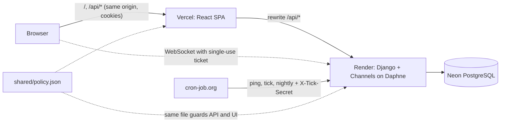

# TalentPath

[](https://github.com/MarepalliAkhil/TalentPath/actions/workflows/ci.yml)

**One platform from job post to an employee's first week.** A candidate finds a job, applies with a resume, is screened with an explainable score, interviewed on a slot the assistant HIRA booked, sent an offer, hired with one click and onboarded, then applies for leave and checks in like any employee. Built alone as a portfolio project by Akhil Marepalli. Every person, company and job in it is fictional.

**Live demo:** `https://<your-app>.vercel.app` (placeholder until deployed; see [docs/DEPLOY.md](docs/DEPLOY.md)) · **For recruiters:** `/for-recruiters` on the live site

> The first request after a quiet spell can take up to a minute: the backend runs on a free plan that sleeps. The app shows "Waking up the server" and retries by itself.

## Try it

Use the **Try as** buttons on the sign-in page, or sign in with any of these (password `Demo@Pass2026` for all):

| Role | Email | Start here |
| --- | --- | --- |
| Candidate | `candidate@demo.example` | My applications, career map, Ask HIRA |
| Recruiter | `recruiter@demo.example` | Ranked candidates with explanations, pipeline board, offers |
| Manager | `manager@demo.example` | Notes and thumbs on candidates, scorecards, leave approvals |
| Employee | `employee@demo.example` | Leave, attendance, internal jobs, onboarding |
| HR | `hr@demo.example` | Offers, hires, analytics, fairness check, HR settings |
| Admin | `admin@demo.example` | Accounts, departments, locations, companies, audit log, email log (no access to candidates' documents) |

Demo data resets every night. Demo accounts cannot change passwords, invite staff or make bulk moves.

## How it fits together



- **One permission file, deny by default.** `shared/policy.json` lists every action and route with the roles allowed. The backend refuses anything not listed; the frontend reads the same file for menus and route guards. A test calls every endpoint as every role.
- **No language model.** Matching, HIRA and the HR assistant are deterministic and rule based, so every answer can be explained and tested.
- **Sensitive data encrypted at rest**: resume text and files, phone numbers, offer terms and leave reasons, with a separate blind index for lookups.

## What it does, by product area

The [For recruiters](frontend/src/pages/public/ForRecruitersPage.tsx) page maps these to public product areas of four Indian HR-tech companies (named in plain text, no claims about their systems).

**Talent experience (career site, mobility)**
- Career site with search, clean job pages, JobPosting structured data, sitemap and robots
- Skill-gap career map: "Jobs you're closest to" and a learning path that respects prerequisites
- Internal mobility with a stated manager-notice rule (told at Interview, never at application)
- Ask HIRA: a rule-based assistant that understands typos and Hinglish and answers only from the asker's own data

**Screening and recruiting automation**
- Explainable 0-100 fit score with reason chips and "what would raise this score"
- Blind screening that hides identity until Interview, and a counterfactual fairness test
- Pipeline board (drag and drop plus keyboard "Move to"), server-enforced stage rules, live updates
- HIRA scheduling: slots from interviewers' working hours, 30-minute holds, a database constraint against double booking, reminders, reschedules and replacements
- Scorecards and offers with two-step approval, a PDF letter and typed-name acceptance

**Employee lifecycle (hire to onboard)**
- One-click hire in one transaction: employee record and ID, same login, checklist, buddy, first-week plan
- HR assistant for leave balance, holidays, onboarding and "apply leave" with a confirmation card
- Hiring and people analytics (time to hire, funnel, offers, interviewer load, leave and attendance) with table views and CSV export

**Leave and attendance**
- Leave policies as data per location: accrual, proration, carry-forward, sandwich rule, half days
- Approvals by reporting line with delegation and escalation after 48 hours
- Team calendar with clash warnings that inform but never block
- Web check-in and check-out, late and early flags, regularisation; no location tracking

## Stack

| Layer | Choice |
| --- | --- |
| Frontend | React 18, Vite, TypeScript, Tailwind CSS, TanStack Query, Zod, dnd-kit, Recharts |
| Backend | Django 5.2, Django REST Framework, SimpleJWT in HttpOnly cookies with CSRF, Channels |
| Data | PostgreSQL (Docker locally, Neon in production); files compressed and encrypted in the database |
| Quality | pytest, Vitest, Playwright with axe, ruff, ESLint, Prettier, GitHub Actions |
| Hosting | Vercel, Render free web service (Docker), Neon free, cron-job.org |

## Run it locally (Windows cmd.exe)

Needs Python 3.12, Node 20+ and Docker Desktop. Full walkthrough: **[docs/START_HERE.md](docs/START_HERE.md)**.

```bat
docker compose up -d db
cd backend
python -m venv .venv
.venv\Scripts\activate
pip install -r requirements-dev.txt
python ..\scripts\generate_env.py
python manage.py migrate
python manage.py seed
python manage.py runserver
```

In a second window:

```bat
cd frontend
npm install
npm run dev
```

Open http://localhost:5173.

## Tests

```bat
cd backend
.venv\Scripts\activate
pytest
ruff check .

cd ..\frontend
npm run lint
npm run typecheck
npm run format:check
npm test
npm run build
npx playwright install chromium
npm run e2e
```

Playwright needs the backend running with fresh demo data (`python manage.py seed --reset`). `e2e/routes.spec.ts` visits every route for every role and fails on any console error or failed request.

Measured results (from the docs, not estimates):

| Check | Result |
| --- | --- |
| Matching, held-out resumes | 16 / 20 ([MATCHING.md](docs/MATCHING.md)) |
| Ask HIRA, held-out questions | 35 / 44 ([ASK_HIRA.md](docs/ASK_HIRA.md)) |
| HR assistant, held-out questions | 27 / 32 ([HR.md](docs/HR.md)) |
| Fairness check | 120 variants, 0 score changes |

## Dependency audits

```bat
cd backend
.venv\Scripts\activate
pip install pip-audit
pip-audit -r requirements.txt

cd ..\frontend
npm audit --omit=dev
npm audit
```

Fix with patch or minor upgrades only (`npm audit fix`, never `--force`); a major upgrade is its own task.

## Deploy for free

Step by step, with every environment variable: **[docs/DEPLOY.md](docs/DEPLOY.md)**.

## Honest limits

- All data is synthetic. Emails and meeting links are simulated; nothing reaches a real inbox or calendar.
- No payroll or payments. No real calendar integration.
- The assistants are rule based: predictable and testable, but narrower than a chatbot.
- One free backend instance: the in-memory channel layer and cache would need Redis for more instances.
- Free hosting sleeps; the first request after 15 quiet minutes waits for the server to wake.

## Documentation

[START_HERE](docs/START_HERE.md) · [ARCHITECTURE](docs/ARCHITECTURE.md) · [DECISIONS](docs/DECISIONS.md) · [PROGRESS](docs/PROGRESS.md) · [DEPLOY](docs/DEPLOY.md) · [MATCHING](docs/MATCHING.md) · [ASK_HIRA](docs/ASK_HIRA.md) · [HIRA](docs/HIRA.md) · [HR](docs/HR.md) · [ANALYTICS](docs/ANALYTICS.md)

## Author

Akhil Marepalli, B.Tech Computer Science, KL University · [GitHub](https://github.com/MarepalliAkhil) · [LinkedIn](https://www.linkedin.com/in/akhil-marepalli-56694532b)
