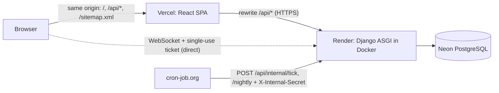

# Architecture

## Overview



- The browser only talks to the Vercel origin. Vercel rewrites `/api/*`, `/sitemap.xml` and `/robots.txt` to Render, so auth cookies are first-party and `SameSite=Lax` works.
- Vercel cannot proxy WebSockets, so live updates connect straight to Render using a ticket from `POST /api/realtime/ticket` (30 seconds, single use). Week 1 still polls the bell every 30 seconds; the socket is ready for later weeks.
- Locally, the Vite dev server plays Vercel's role with a proxy to `localhost:8000`.

## Backend (Django 5.2 + DRF)

| App | Responsibility |
| --- | --- |
| `core` | Policy loader and permission class, cookie JWT auth with CSRF, AES-GCM crypto and blind index, encrypted field, audit log, ping, cron hooks, sitemap and robots |
| `accounts` | User (UUID id, email login, role), Profile (encrypted phone and address), auth endpoints, staff admin |
| `org` | Departments, locations, job levels, skills taxonomy with synonyms (`resolve_skill`) |
| `jobs` | Job model, status rules, role scoping, public career API, SEO and JSON-LD |
| `files` | `StoredFile`: zlib-compressed, AES-GCM encrypted bytes in PostgreSQL (free mode) |
| `applications` | Resume validation and extraction, applications, status history, dashboard summary |
| `notifications` | In-app notifications, simulated email outbox, WebSocket consumer and tickets, demo inbox |
| `seeding` | `seed` and `bootstrap_admin` commands, synthetic PDF/DOCX generators |

### Permissions: one policy file

`shared/policy.json` is the only place that says who may do what.

- Every API view extends `core.views.PolicyAPIView` and names its action (`policy_action`, or `policy_actions` per HTTP method).
- `core.permissions.PolicyPermission` looks the action up. Unknown action or no action means **deny**.
- Tokens: `any`, `authenticated`, `anonymous`, `internal` (cron header), plus the five roles.
- Object scoping happens in the query (for example `jobs.services.visible_jobs`). An object outside your scope answers 404, so its existence is not revealed.
- The frontend reads the same file: `routes` drive route guards and the sidebar, `dashboards` drive redirects after login.
- `tests/test_policy.py` walks every URL pattern, checks each maps to a known action, and calls every endpoint as every role and as an anonymous visitor.

### Authentication

1. `GET /api/auth/csrf` sets the `csrftoken` cookie (readable by JS).
2. `POST /api/auth/login` sets `tp_access` (15 min, path `/`) and `tp_refresh` (7 days, path `/api/auth`), both HttpOnly, `SameSite=Lax`, `Secure` outside local development.
3. Every unsafe request must carry `X-CSRFToken`; `PolicyAPIView.initial` enforces it with Django's own CSRF check, before authentication.
4. On a 401 the SPA calls `POST /api/auth/refresh` once. Refresh tokens rotate and the old one is blacklisted.
5. Logout blacklists the refresh token. A password reset, deactivation or role change revokes all of the user's refresh tokens.
- Passwords use Argon2. Login is rate limited per IP (10/min) and locked per account after 5 failures for 15 minutes. Uploads, registration, password reset and the demo inbox have their own limits.

### Personal data

| Data | Protection |
| --- | --- |
| Phone, address (Profile) | `EncryptedTextField`: AES-256-GCM, random nonce, stored as `v1:<base64>` |
| Phone lookup | `phone_bidx`: HMAC-SHA256 blind index over a normalised value, separate key |
| Resume text | `EncryptedTextField` on `Application` |
| Original resume file | zlib-compressed, then AES-GCM with the file id as associated data, in `files_storedfile.data` |
| Email | Plain text: it is the login identifier (see DECISIONS.md, D-07) |

Keys come from `FIELD_ENCRYPTION_KEY` and `BLIND_INDEX_KEY` (32 bytes, base64). Settings refuse to start if they are missing, malformed or identical.

### Resume pipeline

`applications/resume.py` uses only `pypdf` and the standard library:

1. Reject over 5 MB (also checked from `Content-Length` before reading).
2. Decide the type from the bytes: `%PDF-` or a ZIP that contains `[Content_Types].xml` and `word/document.xml`. File names and browser content types are ignored.
3. DOCX: cap entry count and total uncompressed size (zip-bomb guard), reject DOCTYPE/ENTITY, then read `w:t` runs.
4. PDF: refuse encrypted files, read up to 30 pages.
5. Store the original (compressed, encrypted) and the text (encrypted). Applications are unique per (job, candidate).

### Deployment-ready pieces

| Need | Implementation |
| --- | --- |
| Keep-alive and health | `GET /api/ping`, no authentication, zero DB queries (tested) |
| Scheduled work | `POST /api/internal/tick` and `/nightly`, `X-Internal-Secret` with constant-time compare; tasks in `core/tasks.py` |
| WebSockets behind Vercel | Single-use tickets, `OriginValidator` with `WS_ALLOWED_ORIGINS` |
| No Redis on free tier | `InMemoryChannelLayer` unless `REDIS_URL` is set |
| Ephemeral disk | Files stored in PostgreSQL (`FILE_STORAGE_MODE=db`) |
| Fail fast | Settings raise `ImproperlyConfigured` without required env vars |
| Render | `backend/Dockerfile` (build from repo root), runs `migrate` then `daphne` |

## Frontend (React + Vite)

```
src/
  lib/        api client (cookies, CSRF, refresh), policy + nav, zod schemas, types, hooks (SEO, media query)
  auth/       AuthContext (react-query "me"), RequireRole guard
  components/ AppShell (one sidebar layout for all roles), PublicLayout, ProfileMenu, NotificationBell, ui primitives
  pages/      public/, candidate/, staff/, admin/, shared/
  test/       vitest setup, helpers (axe, fetch mock), page/form/shell tests
e2e/          Playwright smoke tests (desktop and 390 px)
```

- Brand: `tailwind.config.ts` turns `shared/brand.json` colours into CSS variables and Tailwind colours; a Vite plugin fills `%BRAND_NAME%` in `index.html`.
- Accessibility: one `h1` per page, skip link, labelled landmarks, visible focus, `aria-invalid` and `aria-describedby` on fields, keyboard-operable menu and mobile drawer, reduced motion honoured.
- SEO for job pages: the API returns title, meta description, canonical URL and JSON-LD; `useSeo` writes them into the document head.

## Where later weeks plug in

| Week | Hook already in place |
| --- | --- |
| 2: matching, blind screening, fairness | `org.taxonomy.resolve_skill`, skills on jobs, extracted resume text; staff application serializer is the single place to hide identity fields for blind mode |
| 2: pipeline board | `ApplicationStatus`, `STAFF_TRANSITIONS`, `ApplicationEvent` history |
| 3: HIRA reminders | `core/tasks.run_tick`, notification service, WebSocket push |
| 3: hire to onboard | `hired` status reserved; `employee` role and dashboard exist |
| 4: analytics | Status history and audit log give the raw events |
